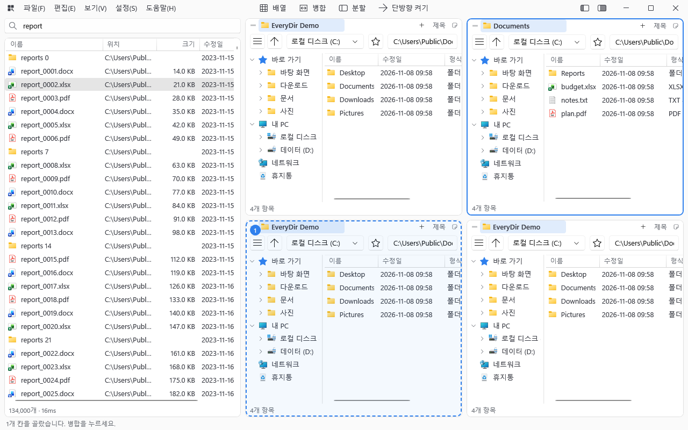

# EveryDir

**여러 칸으로 나눠 쓰는 윈도우 파일 관리자**와 **디스크 전체를 입력하는 즉시 찾는 파일 이름 검색**을 한 창에 담았습니다.

<picture>
  <source media="(prefers-color-scheme: dark)" srcset="images/main-dark.png">
  
</picture>

**[⬇ 최신 버전 받기 (EveryDir.App-win-Setup.exe)](https://github.com/Ranserr/EveryDir/releases/latest)** · 윈도우 10/11 (x64)

이 저장소에는 설치 파일과 업데이트만 올라옵니다. 바뀐 점은 [릴리스](https://github.com/Ranserr/EveryDir/releases)마다 적혀 있습니다.

## 무엇을 하나

### 여러 칸 파일 관리자

- 창을 행×열 칸으로 나눠 폴더를 나란히 봅니다. 처음은 2×2이고, 칸마다 탭·주소창·폴더 트리가 따로 있습니다.
- 칸을 **병합·분할**하고 끌어서 자리를 바꿉니다. **단방향 모드**로 한 칸에서 다른 칸으로만 복사하게 묶을 수 있습니다.
- 복사·이동·삭제, 끌어다 놓기, 우클릭 셸 메뉴는 윈도우 탐색기와 같은 방식입니다. 삭제는 휴지통으로만 합니다. 260자 넘는 경로도 다룹니다.
- **미리보기**(`Space`): 그림, 글자 파일(한글 CP949 포함), 폴더 요약을 칸 오른쪽에 보여 줍니다.
- **이름 일괄 변경**(`Ctrl+F2`): 찾아 바꾸기, 번호 붙이기, 대소문자 바꾸기를 미리 보며 한 번에 적용합니다.
- 즐겨찾기, 뒤로·앞으로, 주소창 자동 완성, 목록 거르기, 칸 제목과 메모, 칸별 글자 크기.
- 큰 폴더나 느린 네트워크 폴더를 읽는 동안에도 창이 멈추지 않습니다.
- 어둡게·밝게 테마, 화면 낭독기와 키보드만으로 쓰기를 지원합니다.

### 빠른 파일 이름 검색

- NTFS 드라이브의 변경 기록(USN 저널)으로 색인을 만들어, 파일이 수십만 개여도 입력하는 즉시 결과가 나옵니다.
- 처음 색인은 파일 약 134만 개인 NVMe SSD 하나에 15초쯤 걸렸습니다(한 대의 PC에서 잰 값). 다음 실행부터는 저장한 색인에서 바뀐 것만 따라잡습니다.
- 결과를 더블클릭하면 활성 칸에서 그 폴더를 열고 파일을 골라 둡니다.
- 검색하는 것은 **파일과 폴더의 이름**입니다. 파일 안의 내용은 찾지 않습니다.

## 설치

1. [최신 릴리스](https://github.com/Ranserr/EveryDir/releases/latest)에서 `EveryDir.App-win-Setup.exe`를 받아 실행합니다.
   설치 없이 쓰려면 `EveryDir.App-win-Portable.zip`을 풀어 씁니다 (이것도 스스로 업데이트합니다).
2. "Windows의 PC 보호" 창이 뜨면 **추가 정보 → 실행**을 누릅니다. 코드 서명을 하지 않은 설치 파일이라 처음 한 번 뜹니다.
3. 관리자 권한 없이 설치되고, 바탕 화면과 시작 메뉴에 바로 가기가 생깁니다. .NET 9 데스크톱 런타임이 없으면 함께 설치합니다.

### 처음 실행하면

- "검색 엔진을 자동으로 켜시겠습니까?"라고 묻습니다. **자동으로 켜기**를 권합니다. 관리자 권한 확인 창이 한 번 뜨고, 그다음부터는 뜨지 않습니다.
- 검색 엔진은 디스크의 변경 기록을 읽어야 해서 **엔진만 관리자 권한**으로 돕니다. 앱 본체는 보통 권한입니다. 엔진을 켜지 않아도 파일 칸은 그대로 쓸 수 있습니다.
- 처음에는 "인덱스를 만드는 중입니다."가 보이고, 드라이브를 다 읽으면 검색됩니다.

## 검색 문법

띄어 쓴 단어와 조건은 모두 만족해야 합니다. 대소문자는 가리지 않습니다.

| 입력 | 뜻 |
|---|---|
| `보고서 2026` | 이름에 두 단어가 모두 들어간 항목 |
| `work\보고서` | `\`나 `/`가 든 단어는 전체 경로에서 찾기 |
| `ext:pdf`, `ext:jpg;png` | 확장자 (`;`로 여러 개 중 하나) |
| `*.pdf`, `rep?rt*` | 와일드카드 (`*` 0글자 이상, `?` 1글자, 이름 전체가 맞아야 함) |
| `file:`, `folder:` | 파일만, 폴더만 |
| `size:>10mb`, `size:<=500kb` | 크기 (`>` `>=` `<` `<=`, 단위 `b` `kb` `mb` `gb`) |
| `dm:today`, `dm:7d`, `dm:2026-11-01` | 수정한 때 (오늘, 최근 7일, 그날) |
| `dm:>2026-11-01`, `dm:<2026-11-01` | 그날 다음부터, 그날 이전 |

예: 지난 7일 안에 고친 PDF `ext:pdf dm:7d` · 10MB 넘는 동영상 `ext:mp4;mkv size:>10mb` · D: 드라이브의 사진 `d:\ ext:jpg;png`

앱 안에서는 **도움말 → 검색 문법**에서 볼 수 있습니다.

## 자주 쓰는 단축키

| 키 | 동작 |
|---|---|
| `F10` (어디서나) | EveryDir 불러오기·숨기기 (설정에서 바꿈) |
| `Ctrl+F` | 검색 |
| `F6` | 다음 칸으로 |
| `Ctrl+Shift+1` / `Ctrl+Shift+2` | 검색 창 / 칸 영역 접기·펼치기 |
| `Space` | 미리보기 열기·닫기 |
| `F2` / `Ctrl+F2` | 이름 바꾸기 / 이름 일괄 변경 |
| `Ctrl+T` / `Ctrl+W` | 새 탭 / 탭 닫기 |
| `Alt+←` / `Alt+→`, `Backspace` | 뒤로 / 앞으로, 상위 폴더 |
| `Ctrl+L` | 주소창 |
| `Ctrl+E` | 지금 폴더 목록 거르기 |
| `Ctrl+D` | 즐겨찾기 추가·제거 |
| `Ctrl+H` | 숨김 파일 보기 |

전체 목록은 **도움말 → 단축키**에 있습니다.

## 업데이트

따로 받을 필요가 없습니다. EveryDir가 시작하고 20초 뒤, 그 뒤로 6시간마다 새 버전을 확인해 받아 둡니다.
받으면 상단 줄에 **업데이트** 단추가 생기고, 누르거나 앱을 끝낼 때 설치됩니다. 바로 확인하려면 **도움말 → 업데이트 확인**.
**설정 → 자동 업데이트**로 끌 수 있습니다.

## 지우기

윈도우 **설정 → 앱 → EveryDir → 제거**. 검색 엔진, 자동 시작 작업, 색인을 함께 지웁니다 (관리자 권한 창 한 번).
앱 설정(`%LOCALAPPDATA%\EveryDir\settings.json`)은 다시 설치할 때 이어 쓰도록 남깁니다. 모두 지우려면 `%LOCALAPPDATA%\EveryDir` 폴더를 지우세요.

## 알아 둘 점

- 검색 엔진은 관리자 권한으로 드라이브 전체(다른 사용자 폴더 포함)의 **파일 이름**을 색인하고, 같은 사용자의 프로그램은 그 이름을 검색할 수 있습니다. 여러 사람이 쓰는 PC에서는 이 점을 알고 쓰세요.
- 검색에 나오는 것은 **NTFS 고정 디스크**뿐입니다. USB, 네트워크, exFAT·FAT32 드라이브는 칸에서 열어 볼 수는 있지만 검색되지 않습니다.
- 창의 닫기(X)는 기본으로 트레이에 숨깁니다. 완전히 끝내려면 **파일 → 끝내기** 또는 트레이 아이콘 → 끝내기.
- 문제가 생기면 로그가 `%LOCALAPPDATA%\EveryDir\app.log`, `engine.log`에 남습니다.
